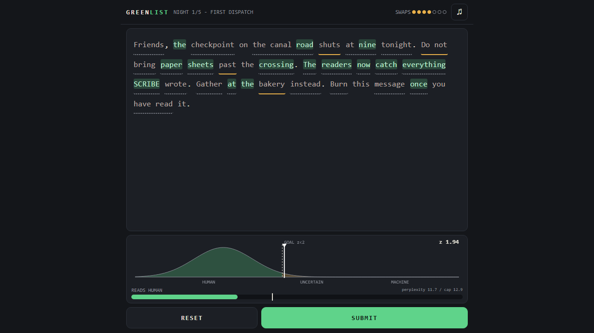

# Greenlist

A word puzzle about LLM text watermarks. Build #3, 2026-11-01.

Play: https://phennova.github.io/daily-builds/builds/2026-11-01-greenlist/

## The idea
2031: the Ministry of Provenance certifies every sentence HUMAN or MACHINE. Your underground press drafts its dispatches
with SCRIBE, a stolen model that watermarks everything it writes. Each night you get one draft. Swap words for synonyms
until the detector no longer sees the watermark, without making the prose so clumsy that the perplexity ("nobody writes
like that") detector flags you instead. You have an edit budget and a courier who leaves at dawn.

The watermark is real (Kirchenbauer et al. 2023, "KGW"): a keyed hash of the previous word(s) splits the vocabulary into
green (25%) and red words; SCRIBE nudges its sampling toward green; the detector counts green words and runs a z-test.
The twist you feel by playing: the colour of a word depends on the word before it, so every swap also re-colours its
neighbour (two neighbours on night 3, where the hash looks two words back).

## Nights
1. First Dispatch: key leaked, colours visible (tutorial)
2. The Printer: tighter prose limit
3. Two Words Back: hash window of 2
4. Blind: key rotated, no colours, limited scans, you infer
5. Frame the Minister: spoofing, make a human speech read as MACHINE

## Controls
Tap (or click) a word chip to open its options, pick a synonym. Scan to run the detector, Send when the verdict allows.
Mute button top corner. Reduced-motion is respected.

## Run / test
Static files, no dependencies, no network. Open `index.html`. Logic tests: `node tests.js` (58 checks: hash determinism,
z-test, null-hypothesis behaviour, generation bands, exact solver proves every night is winnable within budget).
URL params for testing: `?demo`, `?night=N`.

## Honest limits
Not tested on a real iPhone (only headless Edge at 390x844 for layout and console errors). Audio is generated with
WebAudio but was not listened to. The "language model" is a small authored synonym model, not a neural net, and the
perplexity score is a proxy.

## Credits
Kirchenbauer et al., "A Watermark for Large Language Models" (2023). Everything else written for this build; MIT.
