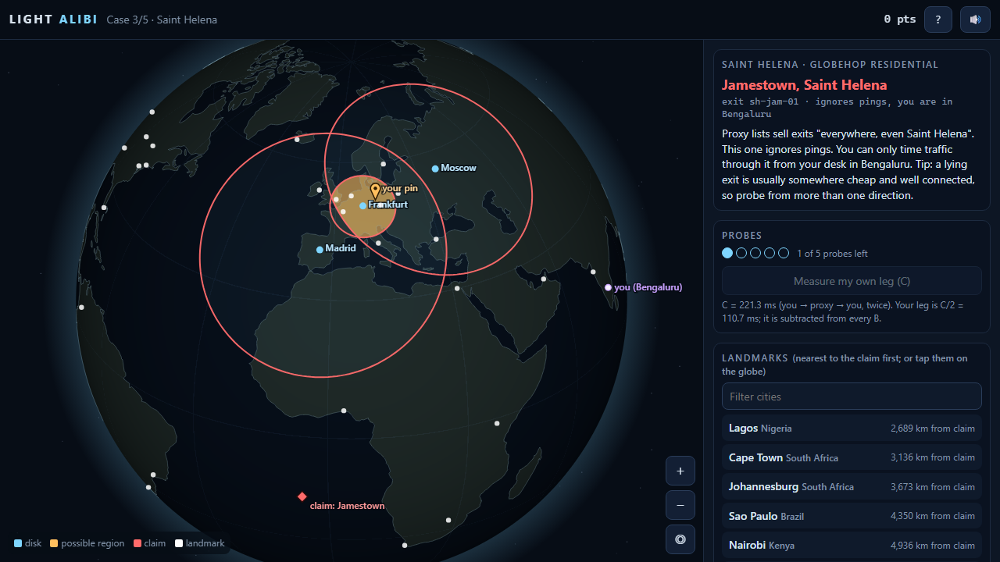

# Light Alibi

Catch lying VPN and residential-proxy exits with the speed of light.

Play: https://phennova.github.io/daily-builds/builds/2026-11-06-light-alibi/

## The idea
A proxy "exit" claims to be in Reykjavik. IP-location databases are easy to fake; physics is not. Ping the suspect from
landmark servers around the world: each round trip becomes a disk on the globe, because a packet cannot travel further than
(RTT / 2) x 200 km/ms (light in fibre). The suspect must lie inside every disk. If the claimed city is outside even one,
the claim is physically impossible. This is Constraint-Based Geolocation, as used in Weinberg et al.,
"How to Catch when Proxies Lie" (IMC 2018).

The catch: RTT only gives upper bounds. You can prove a claim false, never true. Accusing without a disk that excludes the
claim is an unsupported accusation, even if the claim was a lie.

## How to play
- Drag to rotate, wheel / pinch / +- to zoom. Tap a landmark (or its row in the list) to spend a probe.
- Read the disks, choose a verdict ("impossible" or "can't disprove"), drop a pin where the exit really is, submit.
- Unpingable exits (later cases): you can only time you -> proxy -> landmark (B) and you -> proxy -> you (C).
  The landmark leg is B - C/2. Measure your own leg first.
- Some routes are circuitous (detours), so a slow landmark may mean a bad route, not distance. Pick probes wisely.
- 5 handcrafted cases, then an endless night shift. Mute button in the header.

## Run / test
Static page, no dependencies, no network. Open `index.html`.
- `node tests/core.test.js` - geometry, latency model (never faster than light), case solvability, scoring (9978 checks).
- `index.html?selftest` - in-page render and projection checks; `?playtest` - scripted run through all cases; `?demo=N` - screenshot states.

## Credits
Land mask: Natural Earth 110m (public domain), quantised by `tools/make_land.py`. Audio generated with WebAudio.
Not tested on real iOS Safari (layout checked in headless Edge at 390x844 only).
