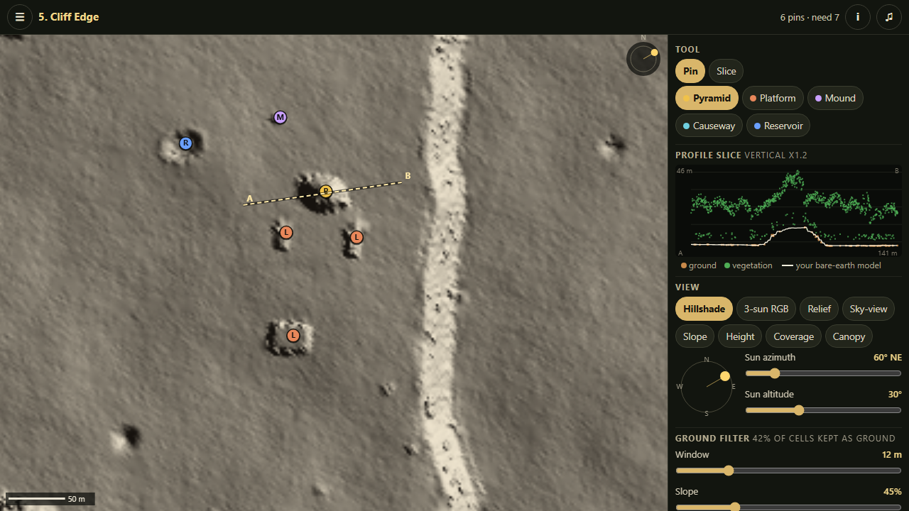

# Bare Earth

Lidar archaeology in the browser. An aircraft has swept 800 m x 800 m of Maya-lowland rainforest with a laser
scanner. You get the raw pulses, not a picture: tune a ground filter, light the bare earth from any sun you like,
slice through the point cloud, and report what people built here before the jungle grew back. The debrief peels
the forest off and shows what was really there.

Play: https://phennova.github.io/daily-builds/builds/2026-11-11-bare-earth/

## How to play
1. Pick a strip. Read the brief (quota, false-positive limit, required features).
2. **Ground filter**: Window and Slope sliders. Too small a window leaves understory "mounds" where no pulse reached
   the ground; too big a window with a tight slope treats a pyramid top like a tree and cuts it off.
3. **Views** (keys 1-8): Hillshade with a draggable sun, 3-sun RGB, Relief (local relief model, with trend radius),
   Sky-view factor, Slope, Height, Coverage (where the filter had real ground points), Canopy (what a satellite sees).
4. **Slice**: switch the tool to Slice and drag a line across a bump. Brown dots are points the filter calls ground,
   green dots are vegetation, the white line is your bare-earth model. A real structure has brown points on it.
5. **Pin**: choose a type (Pyramid, Platform, Mound, Causeway, Reservoir) and tap the map. Tap a pin to remove it.
6. **Submit**. +100 per real feature, +50 if the type is right, -75 per false positive. The debrief explains every
   hit, miss and false positive (karst cone, sinkhole, tree-throw, logging track, filter artefact).

Five strips, each teaching one real idea: Clearing (raking light), High Forest (filter artefacts, profile slices),
Karst (local relief removes hills), Sacbe (a causeway parallel to the sun vanishes in hillshade), Cliff Edge (the
default filter beheads the pyramid). After that: endless random surveys from a seed.

Controls: drag to pan, pinch or mouse wheel to zoom. Keys: 1-8 views, P pin, S slice, arrows pan, +/- zoom, M mute.
Works with touch (phone portrait layout puts the map on top and the tools below).

## The idea
The real archaeologist's pipeline, simulated honestly enough that its failure modes are the puzzles:
- Terrain is fBm noise plus analytic archaeology (stepped and oval pyramids, battered platforms, levelled plazas,
  a raised sacbe, house mounds, reservoirs with spoil berms) and natural decoys (karst cones, sinkholes, tree-throws,
  a sunken curving logging track).
- A canopy of crowns over an understory; each 2 m cell gets ~5 pulses whose returns land on the crown, the
  understory or the ground with probabilities from the cover, plus noise.
- The ground filter is a morphological opening on the lowest return per cell (in the spirit of Zhang et al. 2003 /
  SMRF) using O(n) sliding min/max (monotonic deque), then a slope test and hole filling.
- Visualisations: hillshade, multi-directional RGB hillshade, simple local relief model (Hesse 2010), sky-view factor
  (Zaksek et al. 2011), slope. Everything is computed live on a 400 x 400 grid in plain JavaScript.
- Audio is generated in code (night-jungle ambience from filtered noise, laser sweep, reveal chord). Mute in the bar.

Inspired by a November 2026 Hacker News post about an unmapped Maya site spotted in public NASA G-LiHT lidar.
The sites, strips and institute here are fictional.

## Files and tests
- `sim.js` terrain, archaeology, canopy, pulses, filter, visualisations, profile, scoring (pure, node-testable)
- `game.js` UI, map, tools, screens; `audio.js` WebAudio; `index.html`, `style.css`
- `node tests/sim.test.js` - 34 checks: determinism, pulse stats, filter error, the pyramid-beheading failure mode,
  understory spikes, the hillshade blind azimuth, scoring.
- `node tests/playable.js` - every strip is solvable with sensible settings: feature signal vs noise in the relief
  model, quota reachable with margin, required features visible, and each strip's teaching point really holds.
- `tests/probe.js`, `tests/tune.js` - tuning aids used to pick strip settings (not tests).
- `index.html?selftest` - in-page click-through of every strip, view, tool and the debrief, plus a layout overflow
  check; `?demo` and `?debrief` open screenshot states.

Limits: tested in desktop Edge (including a 390 px wide layout check); not tested on a real iPhone. Audio was not
checked by ear.

Zero dependencies, no network requests. MIT licensed.
